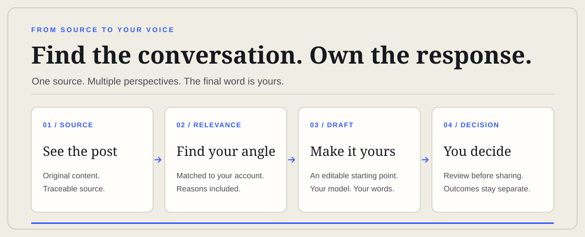

<p align="center">
  <a href="https://ispatla.tr"></a>
</p>

<h1 align="center">ispatla.tr</h1>

<p align="center"><strong>Don’t worship the algorithm. Prove it.</strong></p>

<p align="center">
  Find relevant 𝕏 conversations. See why they fit your account.<br>
  Write in your own voice. Keep the final say.
</p>

<p align="center">
  <a href="https://ispatla.tr">Try the interactive preview</a> ⁜
  <a href="https://ispatla.tr/docs">How it works</a> ⁜
  <a href="CONTRIBUTING.md">Contribute</a>
</p>

<p align="center">
  <a href="https://github.com/OnurByte/ispatla.tr/actions/workflows/social-sharing-ci.yml"></a>
  <a href="LICENSE"></a>
</p>

<p align="center">
  
</p>

## A better starting point for your next post

The hard part isn't generating another paragraph. It's finding a real conversation, knowing why it matters to your audience, and writing something that still sounds like you.

**ispatla.tr puts the original 𝕏 post, account relevance, reasoning and editable draft in one workspace.** Use one account or several. Review drafts individually or together. Nothing in the interactive preview publishes on your behalf.

## See the source. Shape the response.

<p align="center">
  <a href="https://ispatla.tr"></a>
</p>

<sub>Interactive preview shown in Turkish. The source is separate from the editable writing. Try the live version to switch account perspectives, edit, approve and copy a draft.</sub>

- **Source-first:** Open the original 𝕏 post and see where an opportunity came from.
- **Account-aware:** Explore a different angle for each account, with the reasons behind the match.
- **Your voice:** Bring your own AI provider, rewrite the suggestion or start from a blank draft.
- **Your decision:** Prepare a share, then complete it yourself. Observed outcomes retain their evidence level.

## One place for the whole workflow

<p align="center">
  <a href="docs/qa/workspace-tr.png"></a>
</p>

<sub>Dashboard captured during local QA in the Turkish locale. The counts shown are test state, not customer or growth results.</sub>

The signed-in workspace includes account contexts, opportunities, a draft studio and publication records. The repository also includes local stdio and OAuth-protected HTTP [MCP endpoints](https://ispatla.tr/docs#mcp) for scoped research and drafting.

## No black-box promises

An opportunity score is **not** a prediction of virality. Public observations through FxTwitter are **not** official 𝕏 verification. A draft, approval or opened share screen is **not** proof of publication. Official metered 𝕏 data and automated publishing remain disabled until Prime entitlement and budget controls exist.

AI providers and infrastructure may charge fees. This is [open-source software under AGPL-3.0-or-later](LICENSE), not a promise of free external services.

## Run it yourself

Requires Node.js 22.5+ and Bun 1.4.x. The public landing can render without a database; accounts and private workspaces need PostgreSQL.

```sh
bun install --frozen-lockfile
cp .env.example .env
# Set your own database URL and random secrets in .env
bun run dev
```

Use a **fresh development database** and apply the migrations in `supabase/migrations/` in filename order. For Supabase, copy the complete **Connect → Transaction pooler** URI; do not guess its host or username. The app verifies TLS certificates for Supabase connections. Never test migrations against production data.

<details>
<summary>Configuration, MCP and verification</summary>

### Required local configuration

Keep `.env` out of Git. Replace the example values for:

```text
DATABASE_URL=postgresql://<role>:<password>@<host>:<port>/<database>
BETTER_AUTH_URL=http://localhost:3000
BETTER_AUTH_SECRET=<at least 32 random characters>
ISPATLA_TOKEN_KEY_CURRENT=<separate random token key>
ISPATLA_SECRET_KEY=<separate random AI vault key>
ISPATLA_AUTOMATION=0
```

The sample `ISPATLA_PRIVATE_BETA=1` bypasses email verification for development/beta use; do not assume it is suitable for production. Mail delivery requires `ISPATLA_MAIL_API_URL` and `ISPATLA_MAIL_API_TOKEN` pointing to a compatible HTTPS JSON service. Verify delivery separately.

Public-handle analysis needs no 𝕏 password or OAuth grant. Adding a handle does not prove ownership. Optional application sign-in via 𝕏 uses `X_OAUTH_CLIENT_ID` and `X_OAUTH_CLIENT_SECRET`; the application callback is `/api/auth/callback/twitter`. Sign-in is read-only and does not grant posting permission. Its official user lookup may have a provider cost.

### MCP and workers

```sh
bun run mcp
bun run automation:scan
bun run automation:worker
```

The local MCP client uses `ISPATLA_MCP_SESSION_COOKIE`, an actual application session secret. Never put it in Git, logs or shared configuration. Remote clients use `https://<your-origin>/mcp` with OAuth discovery, PKCE, consent and revocable scopes. Draft or publishing-preparation permission never grants automatic posting. Access can be revoked in `/settings/security`. See [MCP setup](https://ispatla.tr/docs#mcp) and [worker setup](docs/RUN-WORKER.md).

### Checks

```sh
bun test --isolate
bun run lint
bun run typecheck
bun run test:seo
bun run build
```

For rendered metadata checks, start a production build locally and run `bun run quality:seo http://localhost:3000`. For Lighthouse, use `LIGHTHOUSE_URL=http://localhost:3000/ bun run quality:lighthouse` with Chrome/Chromium installed. These are local checks, not evidence of live OAuth, mail, billing, indexing or publication.

</details>

## Documentation

[Architecture](docs/ARCHITECTURE.md) ⁜ [Official 𝕏 API boundary](docs/evidence/official-api-boundary.md) ⁜ [Product strategy](docs/PRODUCT_STRATEGY.md) ⁜ [Verification record](docs/BRIEF_ACCEPTANCE.md) ⁜ [Contributing](CONTRIBUTING.md) ⁜ [License](LICENSE)
